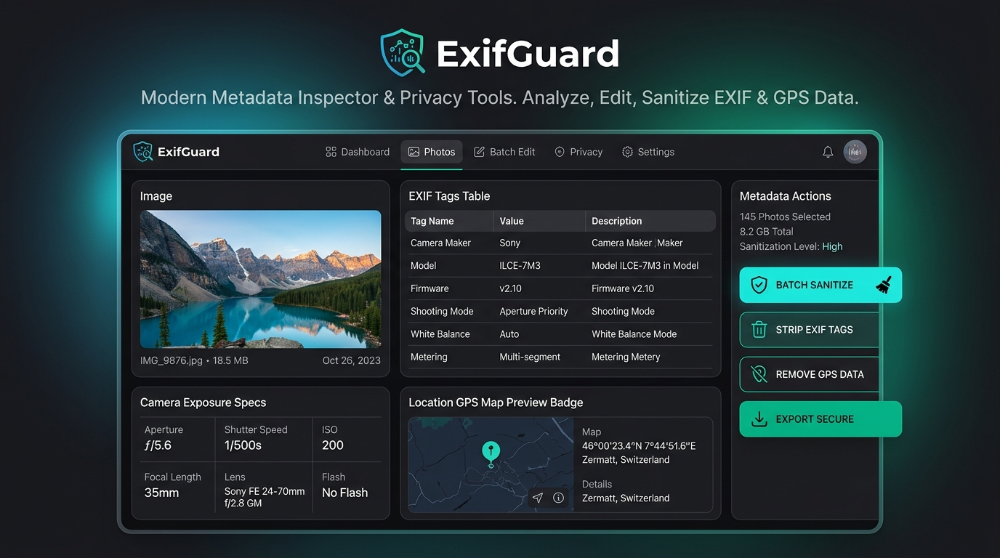
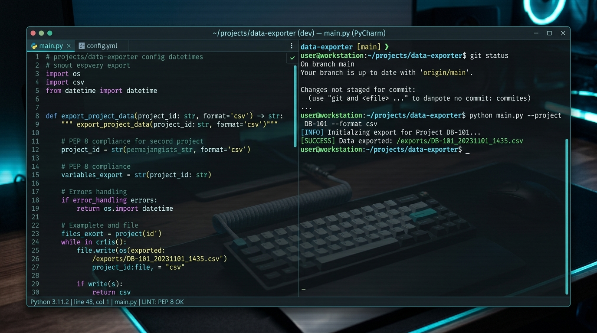

# PyMeta Engine 📷 Terminal & EXIF Metadata Inspector

PyMeta Engine is a modern, high-performance Android application built with Jetpack Compose, Kotlin, and Material Design 3. It combines a visual EXIF metadata inspector, interactive CLI shell (`pymeta`), PEP 8 Python library generator, batch privacy sanitizer, CSV/JSON metadata exporters, and Google Authentication integration.

---

## 📸 Demo & Screenshots

### Image Metadata Inspector

### Interactive CLI Shell & PEP 8 Python Studio

---

## ✨ Key Features

- **🔍 Image EXIF Inspector**: Parse camera metrics (shutter speed, aperture, ISO, focal length, lens model), GPS coordinates with interactive map link launcher, and complete EXIF/IPTC binary tags.
- **⚡ Real-Time Metadata Progress Feedback**: Indeterminate progress indicator & status updates during header parsing and EXIF extraction.
- **💻 Interactive `pymeta` CLI Shell**: Full-fledged command-line environment with command history, auto-completion suggestions, and offline Room database logging.
- **🐍 PEP 8 Python Library Studio**: Automatically generates production-ready, PEP 8 & PEP 257 compliant Python scripts (`pymeta_exif.py`) using `PIL/Pillow`, `exifread`, or native `Piexif` backends.
- **🛡️ Batch Privacy Sanitizer**: Audit your photo catalog for exposed GPS coordinates and sanitize sensitive location telemetry in bulk.
- **📊 CSV & JSON Exporters**: Export extracted metadata into downloadable CSV format or structured JSON for seamless portability and analytical reporting.
- **🔐 Google Authentication**: Integrated Google Sign-In via Credential Manager and Firebase Auth with user profile chip navigation.

---

## 🛠️ CLI Command Reference

| Command Syntax | Description |
| :--- | :--- |
| `pymeta inspect <file\|--all>` | Display extracted EXIF tags, GPS location, and camera specs. |
| `pymeta strip <file\|all> [--gps-only]` | Sanitize sensitive location coordinates or strip all metadata. |
| `pymeta set <file> --artist "..."` | Modify author and IPTC copyright tags. |
| `pymeta export-csv <file\|--all>` | Export extracted metadata into CSV format. |
| `pymeta export-python <file>` | Generate PEP 8 compliant Python script for processing photos. |
| `pymeta diff <file1> <file2>` | Compare metadata differences between two photos. |
| `pymeta hash <file>` | Calculate MD5 and Perceptual hashes. |
| `pymeta help` | Show all available CLI commands and PEP 8 usage guidelines. |

---

## 🏗️ Architecture & Tech Stack

- **UI Framework**: Jetpack Compose with Material Design 3 (Dark Slate & Cyan/Emerald theme).
- **Architecture**: MVVM (Model-View-ViewModel) with Kotlin Coroutines and StateFlow.
- **Local Persistence**: Room Database for CLI command history logging.
- **Authentication**: Credential Manager & Firebase Auth (Google Sign-In).
- **Metadata Engine**: Custom binary EXIF/IPTC parsing with Android ExifInterface.
- **Export Formats**: CSV and JSON format generation.

---

## 🚀 Building & Running

1. Open project in Android Studio (Ladybug or newer).
2. Sync Gradle dependencies (`build.gradle.kts`).
3. Run on Android device or emulator (Android 8.0 / API 26+).
