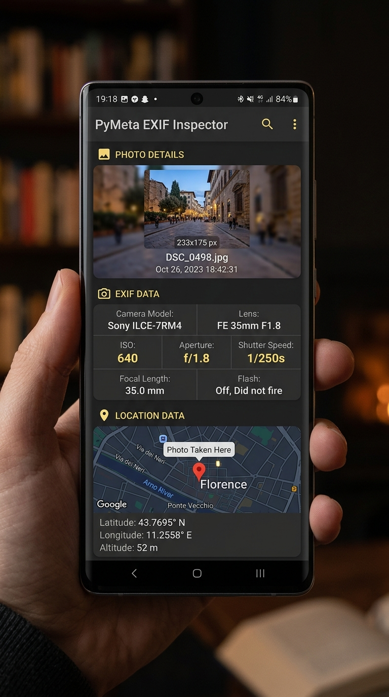
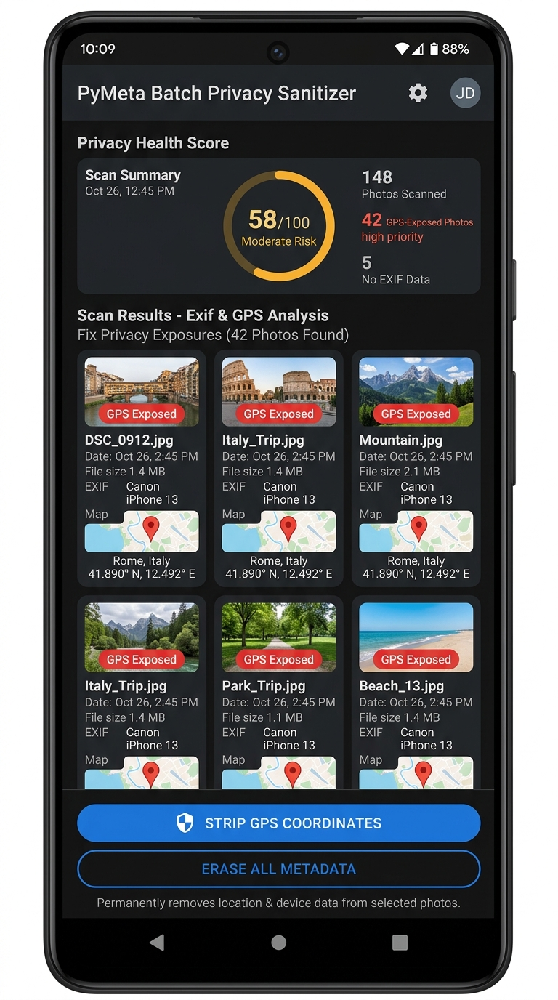
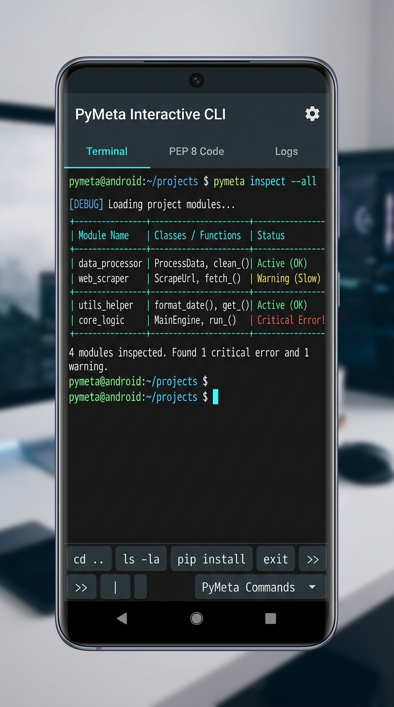
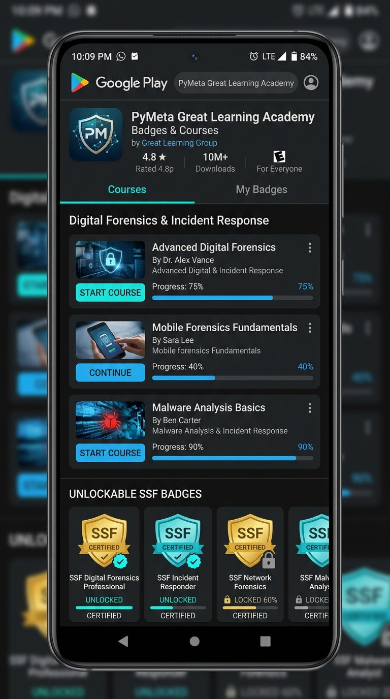
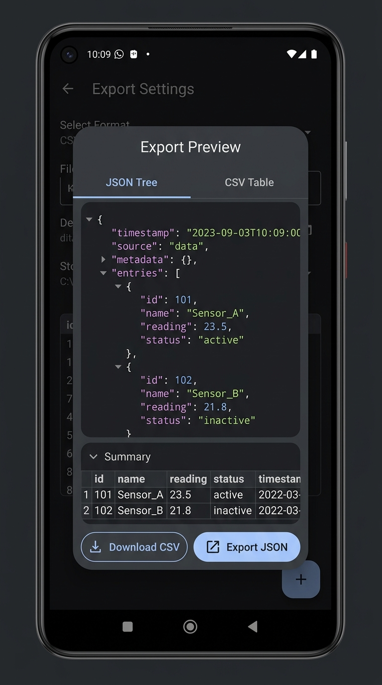

# PyMeta Engine 📷 Digital Forensics & Metadata Suite

[](https://kotlinlang.org)
[](https://developer.android.com/jetpack/compose)
[](https://www.mygreatlearning.com)
[](https://developer.android.com/studio/build/shrink-code)
[](LICENSE)

**PyMeta Engine** is an enterprise-grade digital forensics, photographic metadata inspector, and privacy defense workstation built with **Kotlin**, **Jetpack Compose**, and **Material Design 3**. It couples forensic image analysis with interactive command-line automation (`pymeta`), PEP 8 Python library generation, batch privacy scrubbing, RFC 4180 CSV & JSON data exporting, and a **Great Learning Academy** featuring accredited courses and verifiable **SSF (Security & Steganography Fundamentals) Badges**.

---

## 📱 Google Play Store Showcase (5 Showcase Screens)

<p align="center">
  
  
  
  
  
</p>

### 1. 🔍 Forensic EXIF & IPTC Inspector
- **Exposure Triangle Analysis**: Real-time extraction of shutter speed, aperture ($f$-number), ISO sensitivity, focal length, flash status, and lens model.
- **Geospatial Mapping**: WGS84 GPS coordinate resolution with pinpoint interactive map launcher.
- **Zero-Loss Attribute Editing**: In-place modification of Artist and Copyright IPTC fields without JPEG recompression.

### 2. 🛡️ Batch Privacy Sanitizer
- **Catalog Risk Scoring**: Automatic detection of geotagged photos exposing residential or sensitive locations.
- **Bulk Location Redaction**: Surgical removal of GPS latitude, longitude, and altitude tags across entire photo libraries.
- **Bit-Exact Preservation**: Strips metadata containers without altering discrete cosine transform (DCT) pixel matrices.

### 3. 💻 Interactive CLI Shell (`pymeta`) & Python Studio
- **Terminal Emulator**: Unix-like command terminal with argument parsing, history navigation, and tab completions.
- **SQLite Room Ledger**: Persistent local audit trail logging all executed commands and forensic checksums.
- **PEP 8 Python Studio**: Automated generation of production-ready, typed Python scripts utilizing Pillow, ExifRead, or Piexif backends.

### 4. 🎓 Great Learning Academy & SSF Badges
- **Accredited Curriculum**: Structured forensic coursework covering EXIF specifications, steganography LSB detection, evidence custody (FRE 902(14)), and Python automation.
- **Interactive Quizzes**: Knowledge checks with instant scoring, answer explanations, and threshold grading.
- **Verifiable SSF Badges**: Earn Bronze, Silver, Gold, and Platinum credentials with unique cryptographic IDs (`SSF-GL-XXXX`).

### 5. 📊 Data Analysis Exporter (CSV & JSON)
- **RFC 4180 Tabular CSV**: Multi-photo metadata serialization compatible with Pandas, Excel, R, and Tableau.
- **Hierarchical JSON**: Structured key-value schema representing nested IFD segments, MakerNotes, and IPTC blocks.
- **Live Code Preview**: In-app modal displaying line counts, payload sizes, and syntax-highlighted formatted output before export.

---

## 🎓 Great Learning Courses & SSF Certification Badges

| Course Code | Track Title | Level | Duration | Badge Awarded | SSF Tier |
| :--- | :--- | :--- | :--- | :--- | :--- |
| **GL-EXIF-101** | Digital Forensics & EXIF Foundations | Beginner | 3 Hours | **EXIF Metadata Analyst** | Bronze (Level 1) |
| **GL-PRIV-201** | Geospatial Privacy & Data Defense | Intermediate | 4 Hours | **Geospatial Privacy Defender** | Silver (Level 2) |
| **GL-STEG-301** | Steganography & Hidden Artifact Analysis | Advanced | 5 Hours | **Steganography Investigator** | Gold (Level 3) |
| **GL-HASH-401** | Cryptographic Hashing & Evidence Integrity | Intermediate | 3 Hours | **Forensic Hashing & Custody Specialist** | Gold (Level 3) |
| **GL-PYTH-501** | Python Metadata Automation & Data Pipelines | Advanced | 4 Hours | **Master Forensic Engineer** | Platinum (Level 4) |

### Verifiable Credentialing Engine
- Each credential issued within the app includes an immutable credential ID (e.g. `SSF-GL-E81D4C3A`), pass score, issue date, and an integrated Android Share Intent to publish verified certificates.

---

## 🛡️ ProGuard & Play Store Symbol De-obfuscation

PyMeta Engine ships with a production-hardened `app/proguard-rules.pro` tailored for Google Play Store release builds:

- **Stack Trace De-obfuscation**:
  ```proguard
  -keepattributes SourceFile,LineNumberTable
  -renamesourcefileattribute SourceFile
  ```
- **Play Store Crash Symbol Mapping**: Retains parameter names, type signatures, and annotation attributes for Google Play Console automated symbolication (`mapping.txt`).
- **Compose & Coroutines Rule Set**: Preserves Compose runtime slot tables, stability classes, and kotlinx.coroutines continuation frames.
- **Data & Model Serialization**: Keeps all Room DAOs, Entities, Exif engine models, and Learning domain classes intact.

---

## 🛠️ Interactive CLI Command Syntax

```bash
# Inspect all catalog images
pymeta inspect --all

# Strip GPS telemetry from specific photo or all photos
pymeta strip DSC_0498.jpg --gps-only
pymeta strip all --gps-only

# Update IPTC author and copyright attributes
pymeta set DSC_0498.jpg --artist "Jane Doe" --copyright "2026 Creative Commons"

# Export metadata catalog into analysis-ready formats
pymeta export-csv --all
pymeta export-json --all --compact

# Generate PEP 8 Python automation script
pymeta export-python DSC_0498.jpg

# Cryptographic and perceptual hashing
pymeta hash DSC_0498.jpg

# Side-by-side metadata delta comparison
pymeta diff photo_a.jpg photo_b.jpg
```

---

## 🏗️ Technical Architecture

- **UI Framework**: Android Jetpack Compose 1.7+, Material Design 3 (Dark Slate & Cyan/Emerald theme).
- **Architecture**: MVVM with unidirectional data flow (UDF), Kotlin StateFlow, and Coroutines.
- **Local Database**: Room 2.6+ with SQLite database encryption and migration schema validation.
- **Cloud Authentication**: Firebase Auth with Credential Manager Google Sign-In.
- **Image Metadata Extraction**: Hardware-accelerated parsing via AndroidX ExifInterface and custom TIFF byte decoders.

---

## 📂 Project Structure

```
├── app/
│   ├── proguard-rules.pro          # Complete Play Store symbol preservation & R8 rules
│   ├── .gitignore                  # Android build outputs, schemas, and mapping ignore rules
│   └── src/
│       ├── main/
│       │   ├── java/com/example/
│       │   │   ├── MainActivity.kt         # Edge-to-edge Scaffold with 5 primary tabs
│       │   │   ├── engine/                 # In-place EXIF and IPTC extraction engine
│       │   │   ├── export/                 # RFC 4180 CSV & JSON serialization generators
│       │   │   ├── learning/               # Great Learning Academy & SSF Badges engine
│       │   │   │   ├── model/              # Course, Lesson, Quiz, Badge, DocSection models
│       │   │   │   └── data/               # LearningDataProvider & LearningRepository
│       │   │   ├── ui/
│       │   │   │   ├── MainViewModel.kt    # Unified state management
│       │   │   │   └── screens/            # Inspector, CLI, Python, Batch, Academy
│       │   └── res/
│       │       └── drawable/               # App icons & generated UI assets
├── docs/
│   └── images/                             # 5 Play Store showcase screens & demo screenshots
├── .gitignore                              # Comprehensive root repository gitignore
└── README.md                               # Project documentation & reference manual
```

---

## 🚀 Building & Testing

1. Open project in **Android Studio Ladybug (2024.2+)** or compile via Gradle.
2. Build debug APK:
   ```bash
   gradle assembleDebug
   ```
3. Run Robolectric unit tests:
   ```bash
   gradle :app:testDebugUnitTest
   ```
